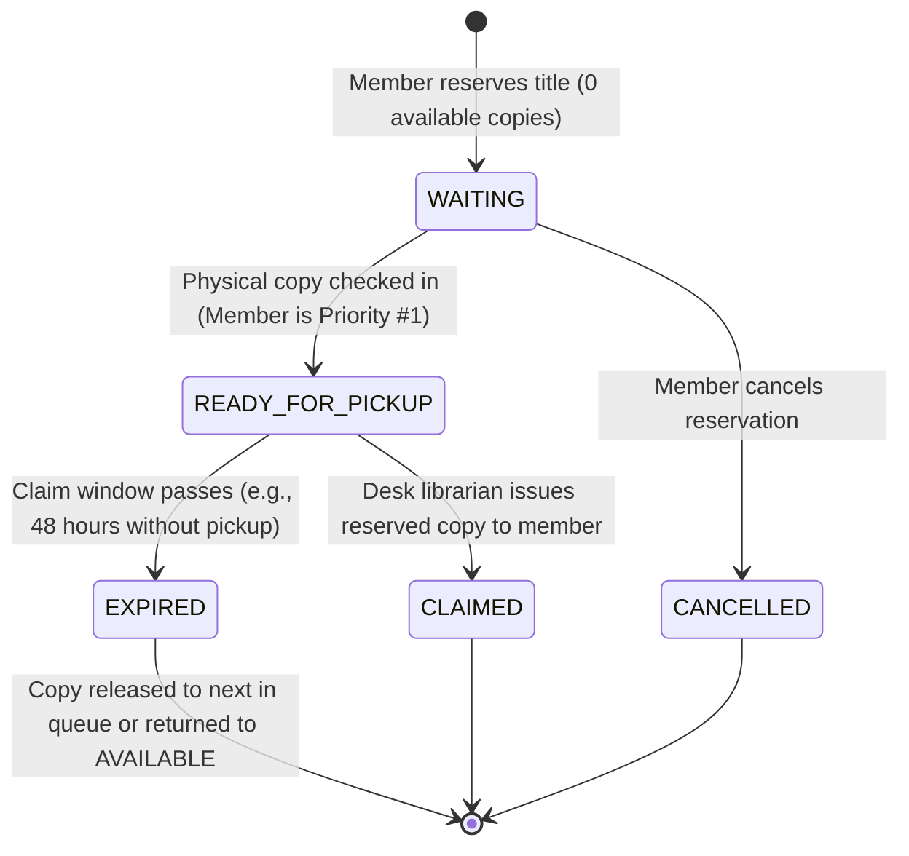

# LIBFLOW — System Architecture & Technical Specification

> **Project:** LIBFLOW Smart Library Management Platform  
> **Classification:** Production-Grade Modular Enterprise Web Application  
> **Document Version:** 1.1.0 (Standardized & Reconciled Architecture)  
> **Tech Stack Baseline:** React 19 • TypeScript • Tailwind CSS • Node.js • Express • TypeScript • MySQL 8+ • mysql2

---

## 1. High-Level Architectural Overview

LIBFLOW follows a clean, decoupled, layered architecture designed for enterprise maintainability, strict separation of concerns, and future multi-tenant SaaS scaling.

```mermaid
flowchart TB
    subgraph ClientLayer ["Client Layer (React 19 + TypeScript + Vite)"]
        UI["Tailwind CSS + Centralized Design Tokens"]
        Components["Component Library (ui, navigation, forms, data-display, feedback)"]
        Store["State Management & Auth Context"]
        APIClient["API Service Layer (Axios / Fetch Typed Clients)"]
        ThreeCanvas["Three.js / React Three Fiber Hero (Isolated & Lazy)"]
    end

    subgraph GatewayLayer ["Network & Security Gateway"]
        CORS["CORS Policy Guard"]
        Helmet["HTTP Security Headers"]
        RateLimiter["IP / Token Rate Limiter"]
        AuthMiddleware["JWT Authentication & RBAC Guard"]
    end

    subgraph ServiceLayer ["Backend Core (Node.js + Express + TypeScript)"]
        Router["Express REST Routers (/api/v1)"]
        Controllers["Controllers (Input Validation & Response Mapping)"]
        Services["Domain Services (Core Business Logic)"]
        Repositories["Data Access Repositories"]
        Jobs["Scheduled Jobs (node-cron: Expiries, Overdues)"]
        AuditService["Enterprise Immutable Audit Service"]
    end

    subgraph DataLayer ["Persistence Layer (MySQL 8+ Engine)"]
        RelationalTables["Relational Schemas (InnoDB, Tenant-Scoped)"]
        DB[(MySQL 8+ Primary Database)]
        Indexes["Compound, Unique & Full-Text Indexes"]
    end

    ClientLayer --> GatewayLayer
    GatewayLayer --> ServiceLayer
    ServiceLayer --> DataLayer
```



### Architectural Principles
1. **Separation of Bibliographic Data and Physical Inventory:** A `Book` is an abstract intellectual work (ISBN, title, author, description). A `BookCopy` is a physical asset with its own unique identifier (`LC-00124`), condition status, shelf placement, and current borrower.
2. **Business Logic Encapsulation:** Circulation logic (borrow limits, grace periods, due dates, fines, queue seniority) is isolated in specialized domain services (`services/`), never inside route handlers or controllers.
3. **Audit-Trail Completeness:** All sensitive operations (borrowing, returning, waiving fines, modifying user privileges, copy status changes) record immutable records via `AuditLog`.
4. **Multi-Tenant Readiness (V1 Simple, SaaS Ready):** Every primary model incorporates `tenantId: string`. For V1, the tenant is `"default-library"`. Future SaaS releases can activate multi-tenant isolation via request tenant-context without altering data contracts.
5. **Lightweight Scheduled Automation:** Background maintenance (reservation hold expirations, overdue notifications) is executed using lightweight Node.js schedules (`node-cron` in `jobs/`) without requiring heavy external queue infrastructure in V1.

---

## 2. Standardized Technology Stack

| Layer | Standardized Technology | Architectural Role |
| :--- | :--- | :--- |
| **Frontend Runtime** | **React 19 + Vite** | Fast modern ESM compiler, Server/Client components readiness, concurrency, strict typing. |
| **Frontend Language** | **TypeScript (v5.x)** | Complete end-to-end interface and DTO type safety. |
| **Styling & Design System** | **Tailwind CSS + Centralized Design Tokens** | Utility-first styling bounded by strict, centralized CSS variables/tokens (fonts, semantic pastels, doppelrand radius). |
| **Micro-Interactions** | **Framer Motion / Motion** | Hardware-accelerated gestures, spring transitions, modal orchestration. |
| **3D Visuals** | **Three.js / React Three Fiber (R3F)** | Isolated strictly to public hero landing; lazy-loaded with WebGL & `prefers-reduced-motion` fallbacks. |
| **Icons & Typography** | **Phosphor Icons (Light) + Plus Jakarta Sans / Newsreader / JetBrains Mono** | Ultra-refined line iconography and editorial typography contrast. |
| **Backend Runtime** | **Node.js (LTS v24.x) + Express.js** | High-performance asynchronous REST API server. |
| **Backend Language** | **TypeScript (v5.x)** | Type-safe controllers, services, repositories, and middleware. |
| **Database Engine** | **MySQL 8+ (mysql2)** | High-performance relational persistence with foreign key constraints, connection pooling, transactional multi-table operations, and version-controlled SQL migrations. |
| **Authentication** | **JWT (Signed Access Tokens) + bcrypt/Argon2** | Stateless authentication with secure RBAC guards; strictly manual auth (no third-party OAuth). |
| **Scheduled Tasks** | **node-cron** | Lightweight scheduled jobs for hold expiry checks and daily overdue fines. |
| **Testing** | **Vitest + React Testing Library + Supertest** | Unified test runner for fast in-memory unit tests and API integration testing. |
| **API Testing** | **Postman** | Standard collection and environment for automated endpoint verification. |

---

## 3. Domain Data Models & Database Schemas

All primary models include `tenantId` (default: `"default-library"`) for seamless future SaaS portability.

```mermaid
erDiagram
    USER ||--o{ AUDIT_LOG : triggers
    USER ||--o| MEMBER : profile
    BOOK ||--|{ BOOK_COPY : contains
    BOOK_COPY ||--o{ BORROW_TRANSACTION : circulates
    MEMBER ||--o{ BORROW_TRANSACTION : borrows
    BOOK ||--o{ RESERVATION : queued_for
    MEMBER ||--o{ RESERVATION : places
    BORROW_TRANSACTION ||--o| FINE : incurs
    USER ||--o{ NOTIFICATION : receives

    USER {
        string id PK
        string tenant_id "default-library"
        string email
        string password_hash
        string role "ADMIN | LIBRARIAN | MEMBER"
        string full_name
        string avatar_url
        boolean is_active
        datetime last_login_at
        datetime created_at
    }

    MEMBER {
        string id PK
        string tenant_id "default-library"
        string user_id FK "References users.id (nullable)"
        string member_id "MEM-2026-XXXX"
        string member_type "STUDENT | FACULTY | RESEARCHER | GENERAL"
        string department
        int active_loans_count
        int max_borrow_limit
        boolean has_overdue_restrictions
        datetime membership_expiry_date
    }

    BOOK {
        string id PK
        string tenant_id "default-library"
        string isbn "Unique ISBN-10 or ISBN-13"
        string title
        string subtitle
        json authors
        string publisher
        string category
        int publication_year
        string edition
        string language
        string description
        string cover_url
        json tags
        int total_copies
        int available_copies
        int times_borrowed
    }

    BOOK_COPY {
        string id PK
        string tenant_id "default-library"
        string book_id FK "References books.id"
        int copy_number
        string copy_code "Unique LC-00124"
        string barcode "Unique Barcode"
        string shelf "e.g. Stack B3, Tier 2"
        string location "Central University Library"
        string condition_rating "NEW | GOOD | FAIR | DAMAGED"
        string status "AVAILABLE | BORROWED | RESERVED | MAINTENANCE | LOST | DAMAGED"
        string current_holder_id
        datetime acquisition_date
        decimal acquisition_cost
    }

    LOAN {
        string id PK
        string tenant_id "default-library"
        string loan_number "Unique Loan Number"
        string member_id FK "References members.id"
        string book_id FK "References books.id"
        string book_copy_id FK "References book_copies.id"
        string copy_barcode
        datetime checkout_date
        datetime due_date
        datetime return_date
        string status "ACTIVE | RETURNED | OVERDUE | LOST | DAMAGED"
        int renewal_count
        decimal fine_calculated
        string issued_by
    }

    RESERVATION {
        string id PK
        string tenant_id "default-library"
        string reservation_number "Unique Hold Number"
        string book_id FK "References books.id"
        string member_id FK "References members.id"
        int queue_position
        string status "WAITING | READY_FOR_PICKUP | CLAIMED | EXPIRED | CANCELLED"
        datetime ready_at
        datetime expires_at
        string assigned_copy_id FK "References book_copies.id"
    }

    FINE {
        string id PK
        string tenant_id "default-library"
        string fine_number "Unique Fine Number"
        string loan_id FK "References loans.id"
        string member_id FK "References members.id"
        decimal original_amount
        decimal amount_paid
        decimal waived_amount
        decimal balance
        int days_overdue
        string status "UNPAID | PARTIALLY_PAID | PAID | WAIVED"
    }

    NOTIFICATION {
        string id PK
        string tenant_id "default-library"
        string recipient_id "Target User or Member ID"
        string recipient_role "ADMIN | LIBRARIAN | MEMBER | ALL"
        string type "BOOK_ISSUED | DUE_SOON | OVERDUE | FINE_LEVIED | HOLD_READY | GENERAL"
        string title
        string message
        string action_route
        boolean is_read
        datetime created_at
    }

    LIBRARY_SETTINGS {
        string id PK
        string tenant_id "default-library"
        string library_name
        string logo_url
        string primary_color
        string secondary_color
        string contact_email
        string phone
        string address
        string website
        int max_books_per_member
        int default_borrow_duration_days
        int max_renewal_limit
        decimal fine_per_day
        int grace_period_days
        decimal max_fine_cap
        int reservation_expiry_hours
        string currency_symbol
        string operating_hours
    }

    AUDIT_LOG {
        string id PK
        string tenant_id "default-library"
        string actor_id
        string actor_role "ADMIN | LIBRARIAN | MEMBER | SYSTEM"
        string action "BOOK_ISSUE | BOOK_RETURN | FINE_WAIVE | ROLE_CHANGE | SETTINGS_CHANGE"
        string entity_type "Book | BookCopy | Loan | Reservation | Fine | User | Settings"
        string entity_id
        json old_value
        json new_value
        string ip_address
        datetime timestamp
    }
```



---

## 4. Reservation State Machine Specification

The reservation workflow follows a deterministic, queue-based state machine:



### State Definitions & Trigger Matrix

| State | Definition | Trigger / Event |
| :--- | :--- | :--- |
| **`WAITING`** | Member is queued in FIFO order waiting for any copy of the book to become available. | Created via `POST /api/v1/reservations`. |
| **`READY_FOR_PICKUP`** | A physical copy was checked in. The copy status changes to `RESERVED` and is locked to this member. A claim countdown begins (default: 48h). Notification dispatched. | Fired automatically by `CirculationService.returnBook()`. |
| **`CLAIMED`** | Member arrives at the desk and checks out the reserved copy. The reservation transitions to terminal success. | Fired by `CirculationService.issueBook()`. |
| **`EXPIRED`** | Member failed to collect the copy within the claim window. The copy is reassigned to the next `WAITING` member or returned to `AVAILABLE`. | Fired by `ReservationExpiryJob` (`node-cron`). |
| **`CANCELLED`** | Member voluntarily withdraws their hold while still in `WAITING`. | Fired via `DELETE /api/v1/reservations/:id`. |

---

## 5. Centralized Fine & Penalty Calculation Engine

All fine and penalty rules are centralized in `FineService.ts`:

### Mathematical Formula
Let:
- $T_{\text{due}}$ = Transaction Due Date
- $T_{\text{return}}$ = Return Date (or Current Date for active loans)
- $G$ = Grace Period in Days (`settings.gracePeriodDays`, default: 2)
- $R$ = Daily Fine Rate (`settings.finePerDay`, default: ₹5.00 / $0.50)
- $C$ = Maximum Fine Cap (`settings.maxFineCap`, default: ₹100.00 / $25.00)

$$\Delta_{\text{days}} = \max\left(0, \left\lceil \frac{T_{\text{return}} - T_{\text{due}}}{86,400,000} \right\rceil\right)$$

$$\text{BillableDays} = \begin{cases} 0 & \text{if } \Delta_{\text{days}} \le G \\ \Delta_{\text{days}} & \text{if } \Delta_{\text{days}} > G \end{cases}$$

$$\text{FineAmount} = \min\left(C, \text{BillableDays} \times R\right)$$

### Rules Enforced by FineService:
1. **Grace Period Protection:** If a member returns a book within the grace period (e.g. 2 days), late fee is ₹0. Once exceeding grace, all overdue days are billed according to library policy.
2. **Deterministic & Testable:** The formula produces identical outputs regardless of whether it is evaluated on return or via daily audit jobs.
3. **Waiver Audit:** Fines can only be waived by an `ADMIN`. Every waiver requires a non-empty `waiverReason`, creating an immutable `AuditLog` entry.

---

## 6. Immutable Audit Logging Specification

Sensitive administrative and transactional actions automatically trigger `AuditService.log()`:

```typescript
export interface IAuditLogRecord {
  tenantId: string;
  actorId: string; // User ID performing the action
  action: 
    | 'BOOK_ISSUE' 
    | 'BOOK_RETURN' 
    | 'RENEWAL_GRANTED' 
    | 'FINE_PAYMENT_RECORDED' 
    | 'FINE_WAIVED' 
    | 'USER_ROLE_CHANGED' 
    | 'SETTINGS_UPDATED' 
    | 'COPY_STATUS_MODIFIED' 
    | 'BOOK_DELETED';
  entityType: 'Book' | 'BookCopy' | 'BorrowTransaction' | 'Reservation' | 'Fine' | 'User' | 'Settings';
  entityId: string;
  oldValue?: Record<string, unknown>;
  newValue?: Record<string, unknown>;
  ipAddress?: string;
  timestamp: Date;
}
```

Audit records are strictly append-only; update and delete operations are prohibited on the `AuditLog` collection.

---

## 7. Standardized Project Directory Structure

### Frontend Structure (`client/`)
```
client/
├── public/                     # Static assets, favicon, fonts
├── src/
│   ├── api/                    # Axios instances & typed API endpoints
│   ├── assets/                 # SVGs, 3D gltf/glb models, branding assets
│   ├── components/
│   │   ├── ui/                 # Atomic UI primitives: Button, Input, Modal, Badge, Card, StatCard...
│   │   ├── navigation/         # Island Nav, Header, Sidebar, Breadcrumbs
│   │   ├── forms/              # FormField, SelectField, Checkbox, Switch, DatePicker
│   │   ├── data-display/       # DataTable, Pagination, Avatar, EmptyState, BookCard
│   │   └── feedback/           # Toast, Alert, Skeleton, LoadingState, ErrorState
│   ├── features/               # Domain feature modules (circulation, catalog, reservations)
│   ├── hooks/                  # useAuth, useDebounce, useMediaQuery, useToast
│   ├── layouts/                # DashboardLayout, PublicLayout, AuthLayout
│   ├── pages/
│   │   ├── public/             # LandingPage (3D Hero), CatalogExplorer, BookDetails
│   │   ├── auth/               # Login, ForgotPassword, ResetPassword
│   │   ├── admin/              # Settings, StaffManagement, Analytics, AuditLogs
│   │   ├── librarian/          # CirculationDesk, Inventory, MemberRecords
│   │   └── member/             # MemberDashboard, Loans, Fines, Holds, Profile
│   ├── lib/                    # Third-party wrappers (three-setup, motion-variants)
│   ├── utils/                  # Date formatters, barcode helpers, currency formatting
│   ├── constants/              # Roles, state enums, default routes
│   ├── types/                  # TypeScript interface definitions (DTOs, domain models)
│   ├── styles/                 # Tailwind base directives & centralized design tokens (tokens.css)
│   ├── App.tsx                 # Route tree & RBAC guards
│   └── main.tsx                # Client bootstrap
├── tailwind.config.ts          # Tailwind CSS configuration mapped to tokens
├── tsconfig.json
└── vite.config.ts
```

### Backend Structure (`server/`)
```
server/
├── config/                     # Database connection, JWT secrets, environment loader
├── controllers/                # Request validation and HTTP response mapping
├── middleware/                 # authMiddleware, roleGuard, errorHandler, rateLimiter
├── models/                     # Mongoose schemas & interfaces (Tenant-scoped)
├── routes/                     # /api/v1 route definitions
├── services/                   # Core business logic (Circulation, Fine, Queue, Catalog, Auth)
├── repositories/               # Direct Mongoose query abstractions
├── validators/                 # Request payload schemas (Zod or Joi)
├── utils/                      # ApiError, ApiResponse, Logger, DateUtils
├── jobs/                       # Scheduled background tasks (node-cron: hold expiry, overdues)
├── constants/                  # System error codes, roles, state machines
├── types/                      # Backend TypeScript type definitions
├── tests/                      # Unit & integration tests (Vitest + Supertest)
├── index.ts                    # Server initialization & Express listener
├── tsconfig.json
└── package.json
```

---

## 8. RESTful API Specification & Envelopes

Base URI: `/api/v1`

### Success Envelope
```json
{
  "success": true,
  "message": "Operation completed successfully",
  "data": { ... },
  "meta": {
    "total": 48,
    "page": 1,
    "limit": 10,
    "totalPages": 5
  }
}
```

### Error Envelope
```json
{
  "success": false,
  "message": "Member has reached the maximum borrowing limit",
  "error": {
    "code": "BORROW_QUOTA_EXCEEDED",
    "details": [
      {
        "field": "memberId",
        "issue": "Active borrows (3) equals quota ceiling (3)"
      }
    ]
  }
}
```

---

## 9. UI Design System & Component State Architecture

Adhering strictly to modern editorial SaaS standards (Linear/Notion-tier typography, haptic depth, warm monochrome palette):

### Design Tokens
- **Backgrounds:** Canvas Bone (`#FBFBFA` / `#F7F6F3`) | Dark OLED Obsidian (`#0D0F11`).
- **Cards & Doppelrand:** Outer container with hairline border (`rgba(0,0,0,0.06)` or `rgba(255,255,255,0.08)`), subtle ambient padding (`p-1.5`), enclosing an inner high-contrast surface.
- **Typography:**
  - Headings / Editorial: `Newsreader` / `Playfair Display`
  - UI / Body: `Plus Jakarta Sans` / `Geist Sans`
  - Code / Barcodes: `JetBrains Mono` / `Geist Mono`
- **Semantic Spot Pastels:**
  - Success/Available: `#EDF3EC` (Text: `#24542B`)
  - Overdue/Critical: `#FDEBEC` (Text: `#9F2F2D`)
  - Warning/Due Soon: `#FBF3DB` (Text: `#8A5B00`)
  - Info: `#E1F3FE` (Text: `#1F6C9F`)

### Universal Component State Matrix
All 27 planned UI primitives must gracefully implement:
`default` • `hover` • `focus-visible` • `active` (with micro-scale `scale(0.98)`) • `disabled` • `loading` (spinner or skeleton) • `error` (accessible inline validation message).

---

## 10. 3D Strategy & Performance Guardrails

- **Scope:** Restricted exclusively to the **Landing Page Hero** (interactive, realistic 3D book model).
- **Technology:** Three.js / React Three Fiber with `@react-three/drei`.
- **Performance Budget:** Dynamic code splitting (`React.lazy`), geometric asset footprint $< 350\text{ KB}$, canvas rendering pauses off-viewport (`IntersectionObserver`).
- **Graceful Fallbacks:** Automatic detection of WebGL capability; if WebGL is unavailable or user enables `prefers-reduced-motion`, render a high-resolution, responsive editorial SVG/raster book mockup.
- **Dashboard Isolation:** Dashboards, desk counters, and tables remain 100% fast, 2D interfaces.

---

## 11. Security Model & Defensive Posture

1. **Password Security:** Scrypt/Bcrypt (minimum 12 salt rounds); password hash excluded by default from queries (`select: false`).
2. **Stateless JWT Sessions:** Access tokens signed with HMAC-SHA256, strictly carrying `sub`, `role`, and `tenantId`.
3. **No Third-Party OAuth:** Standard, manual identity credentials only.
4. **Defense in Depth:**
   - Helmet headers (`X-Content-Type-Options`, `X-Frame-Options`, strict CSP).
   - Rate limiting on authentication routes (maximum 5 failed login attempts per 15-minute window).
   - Parameterized SQL queries and prepared statements via mysql2 to eliminate SQL injection risks.
   - Centralized input schema validation on all POST/PUT payloads.
