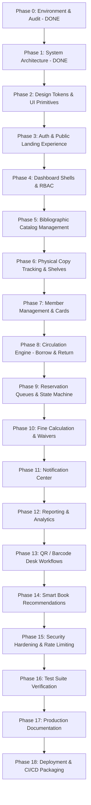

# LIBFLOW - Project Execution Plan & Roadmap

> **Platform:** LIBFLOW Smart Library Management Platform  
> **Status:** Phase 22 Finalized — Portfolio & Submission Pack Complete (All 374 Tests Passing)  
> **Standardized Stack:** React 19 • TypeScript • Tailwind CSS • Node.js • Express • TypeScript • MySQL 8+ • mysql2

---

## 1. Executive Summary & Project Identity

**LIBFLOW** is a modern, high-performance, full-stack library management platform engineered for universities, colleges, research facilities, corporate training academies, and private libraries. Unlike conventional CRUD applications that merely create, read, update, and delete basic book records, LIBFLOW addresses actual operational logistics:

- Physical copy lifecycle & inventory tracking (`Book` vs `BookCopy`)
- Dynamic borrowing policies, renewal constraints, and grace period logic
- Automated fine calculation engine with penalty caps and waiver audit trails
- First-In-First-Out (FIFO) reservation queues with stateful claim windows (`WAITING` → `READY_FOR_PICKUP` → `CLAIMED` / `EXPIRED`)
- Barcode/QR asset identification and fast desk-counter workflows
- Comprehensive role-based access control (Admin, Librarian, Member)
- Multi-dimensional library analytics, utilization metrics, and rule-based recommendation signals
- Scalable, multi-tenant-ready backend architecture ready for future cloud-hosted SaaS deployment

---

## 2. Standardized Technology Stack Selection & Rationale

| Layer | Selected Technology | Architectural Rationale |
| :--- | :--- | :--- |
| **Frontend Framework** | **React 19 + Vite** | Blazing fast HMR, optimized bundle splitting, modern ESM architecture, strict concurrency & server readiness. |
| **Frontend Language** | **TypeScript (v5.x)** | Type safety for API payloads, domain models, and UI component contracts. |
| **Styling & Design System** | **Tailwind CSS + Centralized Design Tokens** | Utility-first styling bounded by centralized CSS custom properties (warm bone palettes, doppelrand borders, typography hierarchy). |
| **Icons & Typography** | **Phosphor Icons (Light) + Plus Jakarta Sans / Newsreader / JetBrains Mono** | Ultra-refined line iconography combined with high-contrast editorial typography. |
| **3D & Interactive Graphics** | **Three.js / React Three Fiber (R3F)** | Isolated exclusively to the landing page hero. Code-split and dynamically imported with WebGL detection and reduced-motion fallback. |
| **Animation Choreography** | **Framer Motion / Motion** | Hardware-accelerated (`transform`, `opacity`), zero layout thrashing, strict `prefers-reduced-motion` compliance. |
| **Backend Runtime** | **Node.js (LTS v24.x) + Express.js** | Non-blocking I/O, mature ecosystem, predictable middleware composition. |
| **Backend Language** | **TypeScript (v5.x)** | Complete backend type safety across controllers, services, repositories, and DTOs. |
| **Database Engine** | **MySQL 8+ (mysql2)** | Relational persistence with foreign keys, transactional multi-table integrity, compound indexing, full-text catalog search, and versioned migrations. |
| **Authentication & Security** | **JWT + bcrypt/Argon2 + Helmet + Express Rate Limit** | Stateless secure session handling, RBAC route guards, OWASP top 10 compliance, input validation schemas via Zod/Joi. |
| **Scheduled Tasks** | **node-cron** | Lightweight cron scheduler for automated hold claim window expiries and daily overdue penalty checks. |
| **Testing** | **Vitest + Supertest + React Testing Library** | Lightning-fast in-memory test runner for business logic unit tests and full API integration suites. |
| **API Testing & Postman** | **Postman Collection & Environments** | Automated collection verification for CI and manual test validation. |

---

## 3. Phased Execution Roadmap (18 Phases)

LIBFLOW is engineered methodically across 18 distinct phases. Each phase has concrete deliverables and acceptance gates.

### Phase Details

- **Phase 0: Environment Audit & Project Initialization (COMPLETED)**
  - Audited local runtime (Node v24, npm 11, Git initialized).
  - Confirmed installed design skills and generated root `.gitignore`.

- **Phase 1: Architecture, Data Schemas & Planning (COMPLETED)**
  - Reconciled tech stack: React 19 + TS, Tailwind + Design Tokens, Node + Express + TS, MySQL 8+ (mysql2), node-cron.
  - Standardized reservation state machine: `WAITING`, `READY_FOR_PICKUP`, `CLAIMED`, `EXPIRED`, `CANCELLED`.
  - Documented relational data schemas and models with tenant readiness (`tenant_id: "default-library"`).

- **Phase 2: Design System & Reusable Component Library (COMPLETED)**
  - Scaffolded Vite React 19 + TypeScript client in `client/`.
  - Configured Tailwind CSS with centralized design tokens in `client/src/styles/tokens.css`.
  - Engineered universal UI component library supporting all 7 states (default, hover, focus, active, disabled, loading, error):
    - UI: `Button`, `IconButton`, `ButtonGroup`, `Input`, `PasswordInput`, `SearchInput`, `Textarea`, `Select`, `Checkbox`, `Switch`, `FormField`, `Modal`, `Dropdown`, `Tooltip`.
    - Navigation: `Sidebar`, `Header`, `Breadcrumb`, `Tabs`.
    - Data Display: `Badge`, `StatusBadge` (14 states), `Card`, `StatCard`, `Avatar`, `AvatarGroup`, `DataRow`, `Table`, `Pagination`, `FilterChip`, `FilterButton`.
    - Feedback: `Alert`, `ToastProvider` & `useToast`, `Spinner`, `Skeleton`, `Progress`, `EmptyState`, `ErrorState`, `LoadingState`.
    - 3D Pipeline: `Hero3DCanvas` with WebGL detection and reduced-motion fallback.
  - Interactive showcase routes verified: `/design-system` and `/dashboard-preview`.

- **Phase 3: Public Landing Page & Secure Authentication (NEXT TARGET)**
  - High-impact editorial hero section with isolated Three.js book showcase.
  - Responsive public pages: Value proposition, interactive catalog peek, feature breakdown, institutional metrics.
  - Secure auth flow: Login, password recovery, session restore, JWT storage strategy, demo one-click credentials selector.

- **Phase 4: Role-Based Navigation & Dashboard Shells**
  - Responsive app layout: Collapsible floating island sidebar, mobile bottom sheet navigation, header with command search and user menu.
  - Role-specific dashboard views: Admin, Librarian, Member.

- **Phase 5: Bibliographic Catalog Management (Books)**
  - Full catalog explorer with faceted filtering (genre, author, publication year, language, shelf).
  - Book creation/edition modal with ISBN auto-formatting, cover upload/URL preview, tag management.

- **Phase 6: Physical Copy Management (BookCopies)**
  - Physical copy inventory table: unique barcode (`LC-XXXX`), shelf tier, condition rating (`NEW`, `GOOD`, `FAIR`, `DAMAGED`), status (`AVAILABLE`, `BORROWED`, `RESERVED`, `MAINTENANCE`, `LOST`).
  - Batch generation of copy records for newly acquired volumes.

- **Phase 7: Member Management & Library Credentials**
  - Member directory with department, academic year/role, active borrowing tally, and restriction flags.
  - Digital library pass preview with printable QR/barcode and checkout history.

- **Phase 8: Circulation Engine (Issue, Return, Renewal)**
  - **Issue Flow:** Fast barcode lookup -> member validation -> policy enforcement -> transaction creation -> copy status update.
  - **Return Flow:** Fast barcode scan -> overdue calculation -> fine ledger entry -> status restoration -> reservation queue notify.
  - **Renewal Flow:** Limit verification -> hold conflict check -> new due date computation.

- **Phase 9: Reservation Queues & State Machine**
  - Strict FIFO queue processing with states: `WAITING`, `READY_FOR_PICKUP`, `CLAIMED`, `EXPIRED`, `CANCELLED`.
  - Claim window countdown trigger upon copy check-in.

- **Phase 10: Fine Calculation Engine & Payment Audit**
  - Configurable penalty policies: Grace period, daily overdue rate, ceiling limit.
  - Automated calculation on return or daily cron evaluation.
  - Librarian fee collection interface & audited administrative waivers.

- **Phase 11: Real-Time Notification Center**
  - In-app notification bell with categorized streams (Due Soon, Overdue, Hold Ready, Fine Assessed, Announcements).

- **Phase 12: Reports & Analytics Engine**
  - Data visualizations: Monthly checkout trends, top borrowed titles, category circulation breakdown, overdue aging report.
  - CSV / PDF export capabilities for institutional accreditation and audits.

- **Phase 13: QR / Barcode Desk Workflows**
  - Interactive barcode scanner simulation for rapid desk transactions.

- **Phase 14: Smart Book Recommendations**
  - Rule-based recommendation engine leveraging borrowing co-occurrence and category affinity.

- **Phase 15: Security Hardening & Backend Hardening**
  - Rate limiting, Helmet, parameterized SQL queries via mysql2, immutable `AuditLog` records for all mutations.

- **Phase 16: Automated & Integration Testing**
  - Vitest + Supertest integration tests for circulation rules, borrowing quotas, and fine formulas.

- **Phase 17: Production Documentation & UML**
  - Comprehensive documentation in `/docs` (SRS, UML diagrams, API specification, database ERD).

- **Phase 18: Deployment Packaging & CI/CD**
  - Docker Compose configuration and production build manifests.

---

## 4. Jira Project Management Breakdown (Epics)

### Epic 1: Project Setup & Standardized Infrastructure
- `LIB-101`: Project scaffolding with Vite React 19 + TypeScript client and Node + Express + TypeScript backend.
- `LIB-102`: MySQL 8+ connectivity, version-controlled schema migrations (`001_initial_schema.sql`), relational data models with tenant scoping, and connection pooling via `mysql2`.
- `LIB-103`: Unified error handling, logger, and response envelopes.

### Epic 2: Design System & Universal UI Primitives
- `LIB-201`: Tailwind configuration integrated with centralized design tokens (`tokens.css`).
- `LIB-202`: Implementation of universal UI primitive suite with 7 component states.
- `LIB-203`: Isolated Three.js 3D book canvas with WebGL detection and reduced-motion fallback.

### Epic 3: Authentication & Identity Management
- `LIB-301`: Secure JWT authentication service (login, logout, refresh, token revocation).
- `LIB-302`: RBAC authorization middleware (`requireRole('ADMIN', 'LIBRARIAN')`).
- `LIB-303`: Quick-fill demo account switcher for portfolios and interviewers.

### Epic 4: Bibliographic & Copy Inventory
- `LIB-401`: Book master catalog schema, CRUD endpoints, and search index.
- `LIB-402`: Physical copy (`BookCopy`) management with unique barcode generation.
- `LIB-403`: Multi-facet catalog search and filtering frontend interface.

### Epic 5: Circulation Engine
- `LIB-501`: Checkout validation logic (quota check, copy availability, restriction flags).
- `LIB-502`: Check-in processing and automatic overdue fine assessment.
- `LIB-503`: Renewal request validation and schedule extension.

### Epic 6: Holds & Reservation State Machine
- `LIB-601`: FIFO reservation queue schema implementing `WAITING` → `READY_FOR_PICKUP` → `CLAIMED` / `EXPIRED`.
- `LIB-602`: Automatic hold fulfillment upon copy return with expiry timeout.
- `LIB-603`: Scheduled cron job for claim window expiration.

### Epic 7: Financial Ledger & Penalties
- `LIB-701`: Configurable fine rules engine (grace days, rate/day, max limit).
- `LIB-702`: Fine payment collection, partial settlement, and waiver audit trails.

### Epic 8: Analytics, Reports & Discovery
- `LIB-801`: Aggregated circulation analytics endpoints and dashboard charts.
- `LIB-802`: Rule-based book recommendation service based on borrowing patterns.
- `LIB-803`: Exportable circulation and overdue ledger reports.

---

## 5. Verification & Acceptance Criteria
For each phase to be marked complete:
1. All newly introduced API routes must return standard success/error envelopes.
2. Business validation rules must be unit-tested or verified against edge cases.
3. Frontend views must be fully responsive across mobile (375px), tablet (768px), and desktop (1280px+).
4. Zero console errors, zero layout breakages, and strict adherence to the design aesthetic.
