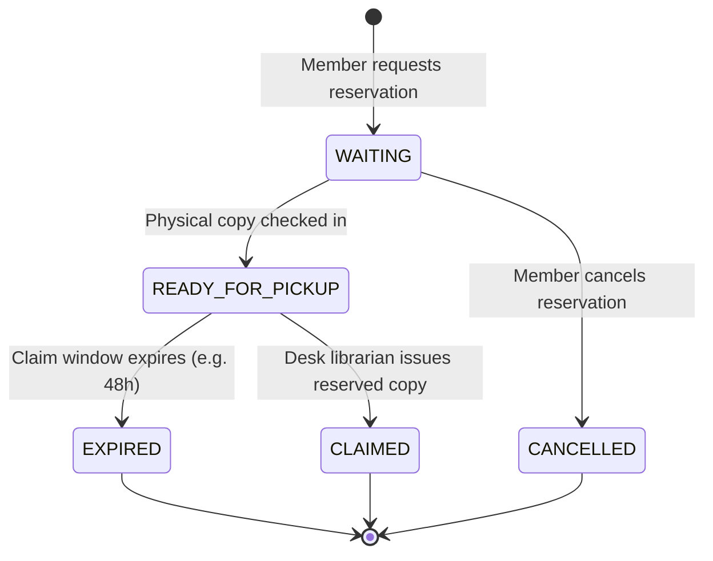

<div align="center">

# LIBFLOW
### Smart Library Management Platform
**"Manage Your Library. Discover Your Next Book."**

[](https://nodejs.org)
[](https://www.typescriptlang.org)
[](https://react.dev)
[](https://tailwindcss.com)
[](https://vitejs.dev)
[](https://www.mongodb.com)
[](LICENSE)

<p align="center">
  A modern, production-grade library circulation and inventory platform engineered for colleges, universities, research academies, and multi-tenant institutions. Built with clean modular TypeScript architecture, physical copy tracking, automated fine calculations, FIFO reservation queues, and an editorial SaaS interface.
</p>

[Architecture Overview](#-architecture) • [Features](#-core-features) • [Quick Start](#-installation--running-locally) • [API Specification](#-rest-api-specification) • [Demo Credentials](#-demo-credentials)

</div>

---

## 📖 Table of Contents
- [Problem Statement](#-problem-statement)
- [The Solution](#-the-solution)
- [Core Features](#-core-features)
- [System Architecture](#-architecture)
- [Tech Stack](#-technology-stack)
- [Project Directory Structure](#-project-directory-structure)
- [Database Schema Design](#-database-schema-design)
- [Reservation State Machine](#-reservation-state-machine)
- [REST API Specification](#-rest-api-specification)
- [Installation & Running Locally](#-installation--running-locally)
- [Environment Configuration](#-environment-configuration)
- [Automated Testing](#-testing)
- [Demo Credentials](#-demo-credentials)
- [Production Deployment](#-deployment)
- [Future Enhancements & Multi-Tenancy](#-future-enhancements--multi-tenancy)
- [Contributing](#-contribution-guidelines)
- [License](#-license)

---

## 🚨 Problem Statement

Most open-source or academic library systems suffer from critical deficiencies:
1. **Conflating Titles with Physical Inventory:** Most systems treat a "Book" as a single row with an integer counter (e.g. `available_count: 5`). They cannot track which physical copy is damaged, which shelf tier it sits on, or which exact barcode (`LC-00124`) a student is holding.
2. **Naive Circulation & Lack of Grace Policies:** Due dates and late fees are often hardcoded without grace periods, dynamic member quotas (faculty vs student), or administrative waiver audits.
3. **Absence of Fair Reservation Queues:** When popular books run out of stock, students must repeatedly check back manually. There is no automated FIFO reservation hold engine.
4. **Poor UI/UX:** Traditional library tools look like 1990s desktop tables or generic low-contrast CRUD admin templates with clumsy interactions.

---

## 💡 The Solution

**LIBFLOW** re-engineers library operations from the ground up:
- **True Physical Asset Management:** Clean separation of bibliographic metadata (`Book`) and discrete serialized physical inventory (`BookCopy`).
- **Dynamic Policy Engine:** Centralized rules for borrowing periods, quota limits, grace periods, daily penalty accruals, and maximum fine ceilings.
- **Automated Hold Pipeline:** First-in, first-out (FIFO) reservation queues that automatically lock returned copies for the next member and dispatch notification alerts.
- **Fast Desk Operations:** Rapid-fire barcode lookup and scan simulator for high-throughput front-desk checkouts and returns.
- **Modern Editorial SaaS Experience:** Built using high-end UI design standards—subtle haptic depth, micro-interactions, responsive mobile views, and accessible layouts.

---

## ✨ Core Features

### 1. Bibliographic & Inventory Management
- Rich bibliographic records (ISBN-10/13, multiple authors, publishers, categories, editions, summaries, cover artwork).
- Serialized copy lifecycle: Barcode/QR ID, shelf location (e.g., `Stack B4, Tier 3`), condition grade, and status (`AVAILABLE`, `BORROWED`, `RESERVED`, `MAINTENANCE`, `LOST`, `DAMAGED`).

### 2. High-Speed Circulation Engine
- **Desk Checkout:** Instant member quota and restriction validation, copy state verification, and automated due date assignment.
- **Desk Check-in:** One-click return flow with automated overdue day calculations and fine ledger generation.
- **Self-Service Renewals:** Controlled renewal permissions with maximum renewal caps and hold-conflict detection.

### 3. FIFO Reservation Queues
- Join reservation queues on checked-out titles.
- Automated allocation of newly returned copies to senior queue members with configurable hold expiration windows (e.g., 48 hours).
- Deterministic state machine: `WAITING` → `READY_FOR_PICKUP` → `CLAIMED` / `EXPIRED`.

### 4. Financial Fine Ledger & Waivers
- Mathematical penalty calculation taking into account configurable grace periods.
- Fine collection management (Cash, Card, Online) and audited administrative waivers with required reasoning.

### 5. Multi-Role Workspaces
- **Admin Workspace:** Institutional parameters, staff management, financial ledger, circulation analytics, audit log inspection.
- **Librarian Workspace:** High-velocity desk scanner, circulation queues, inventory audits, member accounts.
- **Member Portal:** Discovery catalog, live shelf availability, active loan timers, hold queue positions, fine history.

### 6. Rule-Based Book Recommendations
- Contextual reading discovery based on borrowing co-occurrence, category affinity, and popular faculty picks.

---

## 🏛 Architecture

```mermaid
flowchart LR
    subgraph Client ["Client App (React 19 + TypeScript + Vite)"]
        Landing["Editorial Landing & 3D Hero"]
        AdminUI["Admin Control Panel"]
        LibUI["Librarian Circulation Desk"]
        MemUI["Member Discovery Portal"]
    end

    subgraph Server ["Modular API Server (Node + Express + TypeScript)"]
        Auth["JWT & RBAC Guards"]
        CircService["Circulation Service"]
        FineService["Fine & Penalty Engine"]
        QueueService["FIFO Reservation Engine"]
        CatalogService["Catalog & Copy Service"]
        Jobs["node-cron Scheduled Jobs"]
    end

    subgraph Storage ["Database (MongoDB + Mongoose)"]
        Books[(Books & Copies)]
        Loans[(Loans & Holds)]
        Users[(Users & Members)]
        Audit[(Audit Ledger)]
    end

    Client -->|HTTPS / REST API /api/v1| Server
    Server -->|Mongoose ODM| Storage
```



*For complete architectural specifications, see [ARCHITECTURE.md](file:///c:/Users/arsha/Desktop/LIBRARY/ARCHITECTURE.md).*

---

## 🛠 Technology Stack

- **Frontend:** React 19, TypeScript, Vite, Tailwind CSS + Centralized Design Tokens, Phosphor Icons / Clean SVGs, Framer Motion, Three.js / React Three Fiber (Isolated Hero Canvas).
- **Backend:** Node.js v24 (LTS), Express.js, TypeScript, JWT, bcrypt / Argon2, node-cron.
- **Database:** MongoDB, Mongoose ODM with compound indexes and tenant scoping (`tenantId`).
- **Security:** Helmet, CORS Origin Validation, Express Rate Limit, Mongo Query Sanitization.
- **Testing:** Vitest, Supertest, React Testing Library, Postman Collections.

---

## 📂 Project Directory Structure

```
LIBFLOW/
├── client/                     # Frontend Application (React 19 + TypeScript + Vite)
│   ├── public/                 # Static assets & favicon
│   ├── src/
│   │   ├── api/                # Axios API client & typed endpoints
│   │   ├── assets/             # SVGs, 3D models, graphics
│   │   ├── components/
│   │   │   ├── ui/             # Button, Input, Modal, Badge, Card, StatCard...
│   │   │   ├── navigation/     # Island Nav, Header, Sidebar, Breadcrumbs
│   │   │   ├── forms/          # FormField, SelectField, Checkbox, Switch
│   │   │   ├── data-display/   # DataTable, Pagination, Avatar, EmptyState
│   │   │   └── feedback/       # Toast, Alert, Skeleton, LoadingState, ErrorState
│   │   ├── features/           # Domain feature modules (circulation, catalog, holds)
│   │   ├── hooks/              # Custom React hooks (useAuth, useDebounce, etc.)
│   │   ├── layouts/            # Dashboard & Public page layouts
│   │   ├── pages/              # Public, Admin, Librarian, Member route views
│   │   ├── lib/                # Third-party utilities (Three setup, animation variants)
│   │   ├── utils/              # Formatting & helper utilities
│   │   ├── constants/          # Roles, reservation states, route paths
│   │   ├── types/              # TypeScript interfaces & DTOs
│   │   ├── styles/             # Tailwind base directives & centralized design tokens
│   │   ├── App.tsx             # Route definitions & RBAC guards
│   │   └── main.tsx            # Entry point
│   ├── tailwind.config.ts
│   ├── tsconfig.json
│   └── vite.config.ts
│
├── server/                     # Backend API (Node.js + Express + TypeScript)
│   ├── config/                 # Database & JWT configurations
│   ├── controllers/            # Route controllers
│   ├── middleware/             # Auth, RBAC, error & rate-limit middleware
│   ├── models/                 # Mongoose schemas (Book, Copy, Loan, Fine, Audit...)
│   ├── routes/                 # RESTful API route declarations (/api/v1)
│   ├── services/               # Circulation, Fine, & Queue business logic
│   ├── repositories/           # Data access query layer
│   ├── validators/             # Request payload validation schemas
│   ├── utils/                  # Logger, error classes, date calculators
│   ├── jobs/                   # node-cron scheduled background tasks (hold expiry)
│   ├── constants/              # Error codes, system enums
│   ├── types/                  # Backend TypeScript type definitions
│   ├── tests/                  # Unit and integration test suites
│   ├── index.ts                # Server entry point
│   ├── tsconfig.json
│   └── package.json
│
├── docs/                       # Comprehensive documentation & UML
├── ARCHITECTURE.md             # In-depth architectural design
├── PROJECT_PLAN.md             # Phased execution plan & Jira epics
└── README.md                   # Repository overview (this file)
```

---

## 🗄 Database Schema Design

| Collection | Key Fields | Purpose |
| :--- | :--- | :--- |
| **User** | `_id, tenantId, email, passwordHash, role, fullName, avatarUrl, isActive` | Authentication, credentials, and staff privileges |
| **Member** | `_id, tenantId, userRef, memberCode, memberType, department, maxBorrowLimit` | Student/faculty membership rules & quotas |
| **Book** | `_id, tenantId, isbn, title, authors, category, publisher, year, coverImageUrl` | Bibliographic title master catalog |
| **BookCopy** | `_id, tenantId, bookRef, copyNumber, barcode, shelfLocation, condition, status` | Physical serialized inventory with live shelf status |
| **BorrowTransaction** | `_id, tenantId, memberRef, bookCopyRef, issueDate, dueDate, returnDate, status` | Active and historical circulation loans |
| **Reservation** | `_id, tenantId, bookRef, memberRef, queuePosition, status, claimWindowExpiresAt` | FIFO hold queue with strict claim windows |
| **Fine** | `_id, tenantId, transactionRef, memberRef, amount, daysOverdue, status` | Financial penalties, payments, and waiver logs |
| **LibrarySettings** | `_id, tenantId, libraryName, logo, borrowDays, gracePeriodDays, finePerDay` | Centralized institutional configuration & branding |
| **AuditLog** | `_id, tenantId, actorId, action, entityType, entityId, oldValue, newValue, timestamp` | Immutable compliance and security ledger |

---

## 🔄 Reservation State Machine



---

## 🔌 REST API Specification

All responses adhere to the standard envelope:
```json
{
  "success": true,
  "message": "Operation successful",
  "data": { ... }
}
```

### Key Endpoints
- `POST /api/v1/auth/login` — Authenticate and receive JWT session
- `GET /api/v1/books` — Faceted catalog search with pagination
- `POST /api/v1/books` — Register bibliographic record (Librarian/Admin)
- `GET /api/v1/books/:id/copies` — Retrieve all physical copies and shelf locations
- `POST /api/v1/borrowings/issue` — Issue physical copy to member
- `POST /api/v1/borrowings/return` — Check in physical copy & compute late penalties
- `POST /api/v1/reservations` — Reserve unavailable title
- `GET /api/v1/fines` — Query institutional fine ledger
- `POST /api/v1/fines/:id/waive` — Authorize fine waiver (Admin only)
- `GET /api/v1/analytics/overview` — High-level dashboard circulation metrics

---

## 🚀 Installation & Running Locally

### Prerequisites
- **Node.js**: v24+ (LTS)
- **npm**: v11+
- **MongoDB**: Local MongoDB instance or MongoDB Atlas connection URI

### 1. Clone & Setup Repository
```bash
git clone https://github.com/your-username/libflow.git
cd libflow
```

### 2. Configure Environment Variables
Copy `.env.example` to `.env` in both client and server directories:
```bash
cp server/.env.example server/.env
cp client/.env.example client/.env
```

### 3. Install Dependencies
```bash
# Install Server Dependencies
cd server
npm install

# Install Client Dependencies
cd ../client
npm install
```

### 4. Seed Realistic Demo Data
```bash
cd ../server
npm run seed
```

### 5. Launch Development Environment
```bash
# In terminal 1 (Server - Port 5000)
cd server
npm run dev

# In terminal 2 (Client - Port 5173)
cd client
npm run dev
```

Visit `http://localhost:5173` to explore LIBFLOW.

---

## 🔐 Demo Credentials

> ⚠️ **NOTICE:** Demo credentials are provided strictly for local development and portfolio evaluation. Never use demo passwords in production environments.

| Role | Email | Password | Permissions |
| :--- | :--- | :--- | :--- |
| **Admin** | `admin@libflow.io` | `AdminPass123!` | Full institutional management, fine waivers, settings |
| **Librarian** | `librarian@libflow.io` | `StaffPass123!` | Desk circulation, inventory, check-in, check-out |
| **Member (Student)** | `student@libflow.io` | `MemberPass123!` | Catalog discovery, holds, personal loans, fines |

---

## 🧪 Testing

```bash
# Run backend business logic & API tests
cd server
npm test

# Run frontend test suite
cd ../client
npm test
```

---

## 🌐 Deployment

- **Backend:** Ready for containerized deployment on Render, Railway, AWS ECS, or DigitalOcean.
- **Frontend:** Optimized for Vercel, Netlify, or Cloudflare Pages.
- **Docker:** Production `Dockerfile` and `docker-compose.yml` provided for containerized deployment.

---

## 🗺 Future Enhancements & Multi-Tenancy

- **Multi-Tenant Cloud:** Dynamic tenant resolution by subdomain (`harvard.libflow.io`), complete database partition isolation.
- **Hardware Integration:** Web Bluetooth / USB support for physical handheld barcode and RFID readers.
- **Machine Learning Recommendations:** Collaborative filtering engine trained on borrowing co-occurrences.

---

## 🤝 Contribution Guidelines

1. Fork the Project.
2. Create your Feature Branch (`git checkout -b feature/CirculationEngine`).
3. Commit your Changes (`git commit -m 'feat: add overdue grace period calculator'`).
4. Push to the Branch (`git push origin feature/CirculationEngine`).
5. Open a Pull Request.

---

## 📄 License
Distributed under the MIT License. See `LICENSE` for more information.
