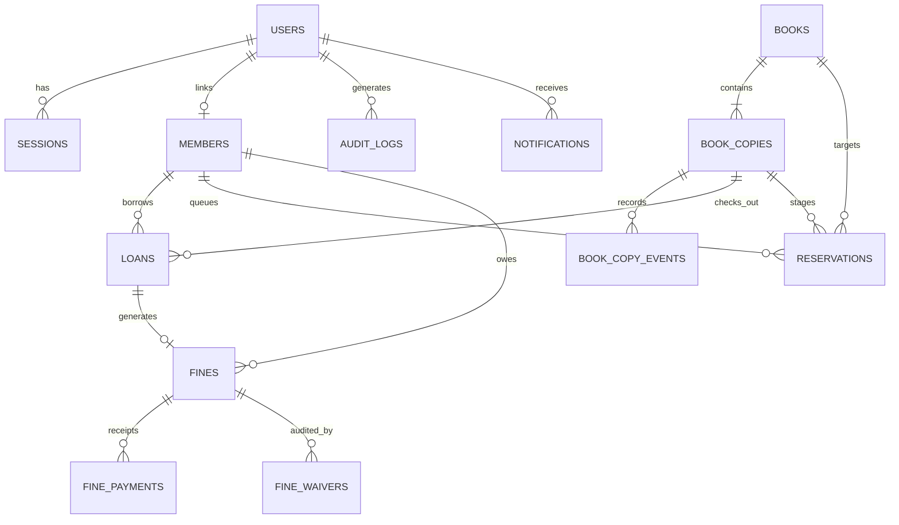

<div align="center">

# LIBFLOW
### Smart Library Management Platform
**"Manage Your Library. Discover Your Next Book."**

[](https://nodejs.org)
[](https://www.typescriptlang.org)
[](https://react.dev)
[](https://tailwindcss.com)
[](https://vitejs.dev)
[](https://www.mysql.com)
[](LICENSE)

<p align="center">
  A modern, production-grade library circulation and inventory platform engineered for colleges, universities, research academies, and multi-tenant institutions. Built with clean modular TypeScript architecture, serialized physical copy tracking, automated overdue fine calculation, FIFO reservation queues, and an editorial SaaS interface.
</p>

[System Overview](docs/PROJECT_OVERVIEW.md) • [Architecture](ARCHITECTURE.md) • [Installation & Setup](#-installation--local-setup) • [API Specification](#-rest-api-specification) • [Seed Accounts](#-seed-accounts--demo-access)

</div>

---

## 📖 Table of Contents
1. [Project Description](#-project-description)
2. [Problem Statement & Objectives](#-problem-statement--objectives)
3. [Main Features & Role-Based Permissions](#-main-features--role-based-permissions)
4. [Technology Stack](#-technology-stack)
5. [System Architecture](#-system-architecture)
6. [Database Schema & Entity Relationships](#-database-schema--entity-relationships)
7. [Prerequisites](#-prerequisites)
8. [Installation & Local Setup](#-installation--local-setup)
9. [Database Setup & Environment Configuration](#-database-setup--environment-configuration)
10. [Database Migrations](#-database-migrations)
11. [Running Client & Server](#-running-client--server)
12. [Testing, Linting & Quality Verification](#-testing-linting--quality-verification)
13. [Demo Mode vs. Live Backend Mode](#-demo-mode-vs-live-backend-mode)
14. [REST API Specification](#-rest-api-specification)
15. [Security Controls & Known Limitations](#-security-controls--known-limitations)
16. [Troubleshooting Guide](#-troubleshooting-guide)

---

## 💡 Project Description

**LIBFLOW** is an enterprise-grade web application engineered to streamline university and institutional library operations. It bridges the gap between bibliographic catalog management and physical desk circulation by treating books as abstract titles and copies as serialized inventory items with distinct barcodes, shelf coordinates, and lifecycle conditions.

The platform provides desk librarians with high-velocity issue/return workflows, patron self-service catalogs, dynamic waitlists with staged hold expirations, automated financial penalty calculation, and role-scoped notifications.

---

## 🚨 Problem Statement & Objectives

### The Problem
Legacy and open-source library systems frequently suffer from architectural shortcuts:
- **Quantity-Based Tracking:** Decrementing a simple counter (e.g. `available: 5`) makes it impossible to know *which* physical volume is lost, damaged, or checked out by an individual student.
- **Inflexible Circulation Rules:** Rigid borrow durations without configurable grace periods, patron-tier quotas (faculty vs student), or administrative waiver logs.
- **Unfair Hold Allocation:** When popular books are returned, they are often snatched up randomly instead of honoring waitlist seniority.
- **Fragile Security:** Storing sensitive access tokens in browser `localStorage`, lacking CSRF guards, and relying on client-side role assertions.

### Objectives
1. **Serialized Asset Separation:** Decouple abstract bibliographic works (`books`) from concrete physical copies (`book_copies`).
2. **Automated State Machines:** Deterministic transitions for loans (`ACTIVE` $\rightarrow$ `RETURNED` / `OVERDUE`) and holds (`WAITING` $\rightarrow$ `READY_FOR_PICKUP` $\rightarrow$ `CLAIMED` / `EXPIRED`).
3. **Audited Financial Ledger:** Transparent overdue fine calculations, partial/full payment tracking, and audited administrator waivers.
4. **Hardened Security:** HttpOnly cookie sessions, double-submit anti-CSRF protection, strict input validation, and zero credentials in client storage.
5. **Editorial User Experience:** Modern responsive interface compliant with WCAG AA accessibility, seamless theme toggling, and clean visual typography.

---

## ✨ Main Features & Role-Based Permissions

LIBFLOW implements Role-Based Access Control (RBAC) across three distinct institutional roles:

| Module / Capability | Administrator (`ADMIN`) | Librarian (`LIBRARIAN`) | Patron (`MEMBER`) |
| :--- | :---: | :---: | :---: |
| **Catalog Search & Book Inspection** | Full | Full | Read-Only |
| **Manage Books & Physical Copies** | Create / Edit / Withdraw | Create / Edit / Withdraw | No Access |
| **Desk Check-Out & Check-In** | Permitted | Permitted | No Access |
| **Loan Renewals** | Permitted (Any Patron) | Permitted (Any Patron) | Self-Service (Own Loans) |
| **Place & Cancel Hold Reservations** | Any Patron | Any Patron | Self-Service (Own Holds) |
| **Claim Ready Hold Pickups** | Desk Processing | Desk Processing | Pick Up at Desk |
| **Fine Collection & Payment Receipts** | Cash / Card / Online | Cash / Card / Online | Pay Outstanding Dues |
| **Fine Waivers (Audited Exemption)** | **Exclusive Authority** | Denied | Denied |
| **Patron Registration & Status Control** | Full Control | Full Control | Edit Contact Only |
| **Analytics & Circulation Reporting** | Complete Dashboard | Circulation Overview | Personal Stats Only |
| **Staff Broadcast Notifications** | Full Authority | Full Authority | Receive Alerts |
| **Digital Member Card & Barcode Pass** | View Any Card | View Any Card | Self-Service Digital Pass |

---

## 🛠 Technology Stack

### Frontend Client
- **Framework:** React 19.2 (Concurrent Features, Hooks)
- **Language:** TypeScript 5.8+ (Strict Type Checking)
- **Build Tool:** Vite 8.3 (High-performance ESM Bundler)
- **Styling:** Vanilla CSS + Tailwind CSS 4 + CSS Design Tokens (`src/styles/tokens.css`)
- **Icons:** Lucide React (Clean SVG icons)
- **3D Graphics:** Three.js (Isolated Hero Canvas with reduced-motion fallback)
- **Testing:** Node.js Native Test Runner (`node --experimental-strip-types --test`)
- **Linter:** Oxlint (High-speed Rust-based linter)

### Backend Service
- **Runtime:** Node.js v24.x LTS (ES Modules `"type": "module"`)
- **Framework:** Express.js 4.21
- **Language:** TypeScript 5.8+ (Strict ESM transpilation via `tsx watch` & `tsc`)
- **Database Driver:** `mysql2/promise` (Connection pool, parameterized queries)
- **Security:** Helmet, CORS, Cookie-Parser, bcrypt (12 rounds)
- **Testing:** Node.js Native Test Runner (`tsx --test`)

### Database
- **Engine:** MySQL 8.0+ Community Server / Enterprise
- **Storage Engine:** InnoDB (Strict Foreign Keys, ACID Transactions, UTF-8mb4)
- **Migrations:** Custom version-controlled SQL migration engine (`src/db/migrator.ts`)

---

## 🏛 System Architecture

LIBFLOW uses a decoupled, three-tier architecture:

```mermaid
flowchart LR
    subgraph ClientLayer ["Client Presentation (React 19 + TypeScript + Vite)"]
        UI["Tailwind CSS + Tokens"]
        Contexts["Domain Contexts"]
        ApiClient["Typed API Client"]
    end

    subgraph SecurityGateway ["Security & Middleware Gateway"]
        HelmetMW["Helmet Headers"]
        CorsMW["CORS Guard"]
        CookieMW["HttpOnly Cookies"]
        RateLimitMW["Brute-Force Limiters"]
        AuthMW["Session & RBAC Guards"]
        CsrfMW["Anti-CSRF Validator"]
    end

    subgraph BackendLayer ["Backend API Service (Node.js + Express + TS)"]
        Routes["REST Routers (/api/v1)"]
        Controllers["Input Controllers"]
        DomainServices["Domain Services (Circulation, Fines, Holds)"]
    end

    subgraph DatabaseLayer ["Persistence Tier (MySQL 8+)"]
        Pool["mysql2 Connection Pool"]
        Tables[("16 Relational Tables")]
    end

    ClientLayer -->|Credentials Included| SecurityGateway
    SecurityGateway --> BackendLayer
    BackendLayer --> Pool
    Pool --> Tables
```



---

## 🗄 Database Schema & Entity Relationships

The relational database schema is structured into **16 tables** in `libflow_db`:



### Core Relational Entities
1. `users` — Authentication credentials (bcrypt hash), institutional roles (`ADMIN`, `LIBRARIAN`, `MEMBER`).
2. `members` — Patron profiles, academic programs, borrow limits, restriction flags.
3. `books` — Master bibliographic title catalog (ISBN, title, authors, publisher, year, subject).
4. `book_copies` — Serialized physical assets (barcode, shelf location, condition, live status).
5. `loans` — Active and historical circulation loans (issue date, due date, return date, renewals).
6. `reservations` — Deterministic FIFO waitlists with 48-hour pickup expiration timers.
7. `fines` — Overdue penalty ledger (amount, balance, days overdue, status).
8. `fine_payments` — Payment records (Cash, Card, Online).
9. `fine_waivers` — Administrator waivers with mandatory justification reason.
10. `notifications` — Role-scoped alert notifications and staff broadcasts.
11. `audit_logs` — Immutable administrative event audit trail.
12. `sessions` — Server-managed session tokens for HttpOnly cookie authentication.

---

## 💻 Prerequisites

Ensure your development environment meets the following requirements before installation:
- **Node.js**: `v24.x LTS` (or `v20.x+`)
- **npm**: `v10.x+` or `v11.x+`
- **MySQL Server**: `MySQL 8.0+` active and running locally on port `3306`

---

## 🚀 Installation & Local Setup

### 1. Clone the Repository
```bash
git clone https://github.com/your-username/libflow.git
cd libflow
```

### 2. Install Server Dependencies
```bash
cd server
npm install
```

### 3. Install Client Dependencies
```bash
cd ../client
npm install
```

---

## ⚙️ Database Setup & Environment Configuration

### 1. Create MySQL Database & User
Log in to your local MySQL console:
```sql
CREATE DATABASE IF NOT EXISTS libflow_db CHARACTER SET utf8mb4 COLLATE utf8mb4_unicode_ci;
CREATE USER IF NOT EXISTS 'libflow_user'@'localhost' IDENTIFIED BY 'your_secure_password';
GRANT ALL PRIVILEGES ON libflow_db.* TO 'libflow_user'@'localhost';
FLUSH PRIVILEGES;
```

### 2. Configure Backend Environment (`server/.env`)
Copy `server/.env.example` to `server/.env`:
```bash
# In server/ directory
cp .env.example .env
```
Update your `.env` with your local MySQL credentials:
```env
NODE_ENV=development
PORT=5000
API_PREFIX=/api/v1
CORS_ORIGIN=http://localhost:5173
CLIENT_URL=http://localhost:5173
REQUEST_LIMIT=1mb
LOG_LEVEL=info

DB_HOST=localhost
DB_PORT=3306
DB_USER=libflow_user
DB_PASSWORD=your_secure_password
DB_NAME=libflow_db
DB_CONNECTION_LIMIT=10

SESSION_COOKIE_NAME=libflow_session
SESSION_TTL_HOURS=168
PASSWORD_RESET_TOKEN_TTL_MINUTES=60
AUTH_RATE_LIMIT_MAX=5
AUTH_RATE_LIMIT_WINDOW_MINUTES=15
```

### 3. Configure Frontend Environment (`client/.env`)
Copy `client/.env.example` to `client/.env`:
```bash
# In client/ directory
cp .env.example .env
```
Ensure the API URL points to your local Express server:
```env
VITE_APP_ENV=development
VITE_API_BASE_URL=http://localhost:5000/api/v1
VITE_DEFAULT_TENANT_ID=tenant_central
VITE_AUTH_MODE=live
VITE_ENABLE_MOCK_AUTH=true
VITE_ENABLE_ANALYTICS=true
VITE_ENABLE_BARCODE_SCANNER=true
```

---

## 🔄 Database Migrations

LIBFLOW uses a version-controlled SQL migration runner to track applied database changes.

```bash
# From the server/ directory:
# Check status of applied migrations
npm run migrate:status

# Apply pending schema migrations (001_initial_schema.sql, 002_auth_and_sessions.sql)
npm run migrate
```

*Note: Migrations are safe and idempotent (`CREATE TABLE IF NOT EXISTS` and `INSERT IGNORE`). Running them will not reset or delete existing library data.*

---

## 🏃 Running Client & Server

Launch both services in separate terminal windows:

### Terminal 1: Backend Express API Server
```bash
cd server
npm run dev
```
Output:
```
================================================================
 LIBFLOW Smart Library Management Platform — API Server
 Environment : development
 Port        : 5000
 Base API    : http://localhost:5000/api/v1
 Health URL  : http://localhost:5000/api/v1/health
 Allowed CORS: "http://localhost:5173"
================================================================
```

### Terminal 2: Frontend Vite Development Server
```bash
cd client
npm run dev
```
Output:
```
  VITE v8.3.x  ready in ~500 ms

  ➜  Local:   http://localhost:5173/
  ➜  Network: use --host to expose
```

Open your browser at **[http://localhost:5173/](http://localhost:5173/)** to access LIBFLOW.

---

## 🧪 Testing, Linting & Quality Verification

All test suites and build pipelines can be executed with standard npm scripts:

### Frontend Client Quality Checks
```bash
cd client

# Run all 208 client domain, RBAC, and mapper tests
npm test

# Run TypeScript compilation and production Vite build
npm run build

# Run Oxlint static code analysis
npm run lint

# Run security audit on client dependencies
npm audit
```

### Backend Server Quality Checks
```bash
cd server

# Run all 114 backend unit tests
npm run test:unit

# Run all 52 live MySQL integration tests (requires active MySQL)
npm run test:integration

# Run entire server test suite (unit + integration)
npm test

# Run TypeScript compilation build
npm run build

# Run security audit on server dependencies
npm audit
```

---

## 🎭 Demo Mode vs. Live Backend Mode

LIBFLOW supports two distinct operational modes controlled via `VITE_AUTH_MODE` in `client/.env`:

| Mode | Configuration | Characteristics | Typical Usage |
| :--- | :--- | :--- | :--- |
| **Demo Mode** | `VITE_AUTH_MODE=demo` | Self-contained client-side state stored in memory/localStorage. Instant quick-login buttons. Works without backend or MySQL. | Offline evaluation, UI walkthroughs, rapid portfolio exploration. |
| **Live Backend Mode** | `VITE_AUTH_MODE=live` | Connects directly to the Express backend and MySQL database via HttpOnly cookie sessions (`libflow_session`). Strict server-side RBAC and real-time database persistence. | Production, full-stack integration testing, real library operations. |

---

## 🔐 Seed Accounts & Demo Access

The database seed migrations include pre-configured accounts matching both live MySQL and demo fixtures:

| Role | Email Identifier | Password | Access Scope |
| :--- | :--- | :--- | :--- |
| **System Administrator** | `admin@libflow.demo` *(or `admin@libflow.io`)* | `AdminPass123!` | System settings, member registry, fine waivers, analytics. |
| **Circulation Librarian** | `librarian@libflow.demo` *(or `librarian@libflow.io`)* | `StaffPass123!` | Front desk, issue/return scanner, hold pickup claims, payments. |
| **Institutional Patron** | `member@libflow.demo` *(or `student@libflow.io`)* | `MemberPass123!` | Catalog discovery, digital card, personal loans, hold queues, dues. |

*Quick Access Tip:* On the [Login Page](http://localhost:5173/login), click the helper pills (**Admin**, **Librarian**, **Member**) to automatically populate credentials.

---

## 🔌 REST API Specification

All API endpoints reside under `/api/v1` and return standardized envelopes:
```json
{
  "success": true,
  "message": "Operation successful",
  "data": { ... }
}
```

### Key API Endpoints

| Category | Method | Path | Required Role | Description |
| :--- | :---: | :--- | :---: | :--- |
| **System** | `GET` | `/api/v1/health` | Public | System status, memory telemetry, and MySQL connection health. |
| **Auth** | `POST` | `/api/v1/auth/login` | Public | Authenticate user, issue HttpOnly session and CSRF cookies. |
| | `POST` | `/api/v1/auth/logout` | Authenticated | Invalidate server session and clear session cookies. |
| | `GET` | `/api/v1/auth/me` | Authenticated | Retrieve authenticated user profile and member attributes. |
| | `POST` | `/api/v1/auth/forgot-password`| Public | Request password recovery email (anti-enumeration). |
| | `POST` | `/api/v1/auth/reset-password` | Public | Consume single-use cryptographic recovery token. |
| **Books** | `GET` | `/api/v1/books` | Authenticated | Faceted catalog search with pagination and category filters. |
| | `POST` | `/api/v1/books` | Staff | Register bibliographic title record. |
| | `GET` | `/api/v1/books/:id/copies` | Authenticated | List physical copies (cost redacted for patrons). |
| | `POST` | `/api/v1/books/:id/copies` | Staff | Add serialized physical copy with barcode and shelf location. |
| **Circulation** | `POST` | `/api/v1/loans/checkout` | Staff | Issue an available physical copy to a verified member. |
| | `GET` | `/api/v1/loans/me` | Member | Retrieve patron's active and historical loans. |
| | `POST` | `/api/v1/loans/:id/return` | Staff | Process return, assess overdue penalties, and stage holds. |
| | `POST` | `/api/v1/loans/:id/renew` | Member/Staff | Extend active loan due date (subject to hold conflicts). |
| **Holds** | `POST` | `/api/v1/reservations` | Authenticated | Place a hold in the FIFO reservation waitlist. |
| | `GET` | `/api/v1/reservations/me` | Member | Retrieve member's personal hold queue positions. |
| | `POST` | `/api/v1/reservations/:id/claim`| Staff | Fulfill a staged pickup reservation and generate loan. |
| | `POST` | `/api/v1/reservations/:id/cancel`| Patron/Staff| Cancel a hold and shift queue seniority forward. |
| **Fines** | `GET` | `/api/v1/fines/me` | Member | Retrieve member's outstanding fine ledger. |
| | `POST` | `/api/v1/fines/:id/pay` | Staff/Member | Record partial or full fine payment. |
| | `POST` | `/api/v1/fines/:id/waive` | **ADMIN** | Waive fine balance with mandatory audited justification. |
| **Analytics**| `GET` | `/api/v1/analytics/dashboard` | Staff | System metrics, category breakdown, and fine recovery. |
| **Barcodes** | `GET` | `/api/v1/barcodes/scan/:code`| Authenticated | Scan copy or member card barcode with privacy protection. |

*For complete details, see [docs/PROJECT_OVERVIEW.md](docs/PROJECT_OVERVIEW.md).*

---

## 🔒 Security Controls & Known Limitations

### Security Architecture
- **HttpOnly Cookie Sessions:** Neutralizes JavaScript credential theft via XSS.
- **Double-Submit Anti-CSRF:** Requires matching `x-csrf-token` header on all modifying requests.
- **Strict Parameterization:** Prohibits raw SQL concatenation via `mysql2` placeholders.
- **Password Protection:** 12-round `bcrypt` salting; zero password hashes returned in API envelopes.
- **Brute-Force Defense:** Rate limiters block rapid password guessing attacks.

### Known Limitations (V1 Scope)
- **Single Active Tenant:** Relational schemas include `tenant_id` on all tables, but automated tenant subdomain switching is scheduled for V2.
- **Hardware Integration:** Barcode input is handled via keyboard emulation and simulated QR events rather than native WebUSB/WebBluetooth drivers.
- **Cron Jobs:** Overdue penalty assessments run via in-process Node.js schedules (`node-cron`) rather than external distributed queue infrastructure.

---

## 🔧 Troubleshooting Guide

| Issue | Probable Cause | Verified Resolution |
| :--- | :--- | :--- |
| **`ECONNREFUSED 127.0.0.1:3306`** | MySQL server is stopped or port is blocked. | Verify MySQL service is running via Windows Services (`services.msc`) or run `net start MySQL80`. Check `DB_PORT=3306` in `server/.env`. |
| **`ER_ACCESS_DENIED_ERROR`** | Invalid database credentials in `server/.env`. | Verify `DB_USER` and `DB_PASSWORD` in `server/.env` match your MySQL account permissions. |
| **CORS Blocked in Browser** | Origin mismatch between client and server. | Ensure `CORS_ORIGIN=http://localhost:5173` in `server/.env` and `CLIENT_URL=http://localhost:5173`. |
| **Login says "Authentication Failed"** | Incorrect mode or unmigrated database. | Ensure migrations were executed (`npm run migrate`). Use the quick seed buttons on the login page. |
| **Port 5000 / 5173 Already in Use** | A previous instance is still running in the background. | In PowerShell: `Get-Process node \| Stop-Process` or kill background tasks via `npm run dev`. |
| **Anti-CSRF Validation Failed (403)** | Missing `x-csrf-token` header or expired cookie. | Ensure browser accepts cookies. Log in again to re-issue session and CSRF cookies. |

---

## 📄 License

Distributed under the MIT License. See `LICENSE` for more information.
