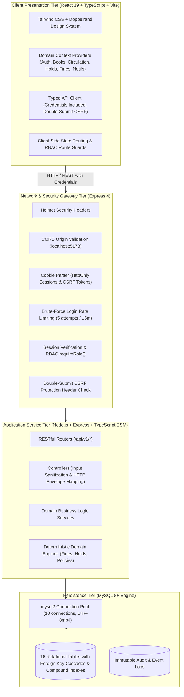
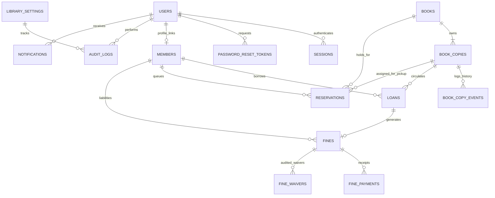
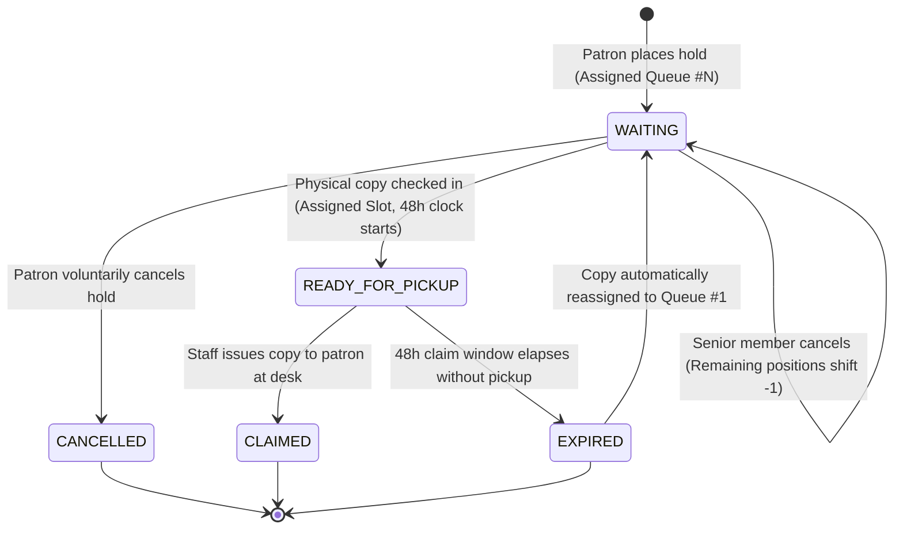

# LIBFLOW — Comprehensive Project Overview & System Specification

> **Classification:** Academic & Portfolio Project Submission  
> **Platform Version:** 2.0.0 (Standardized Production-Grade Implementation)  
> **Core Stack:** React 19 • TypeScript • Vite • Tailwind CSS • Node.js • Express • MySQL 8+  
> **Repository Location:** `C:\Users\arsha\Desktop\LIBRARY`

---

## 1. Executive Summary & Problem Statement

Institutional libraries in universities, research institutes, and academies handle complex daily workflows involving thousands of serialized books, high-velocity borrowing, hold queues, and late payment liabilities. 

Traditional library systems and existing open-source alternatives suffer from major architectural deficiencies:
1. **Conflating Bibliographic Titles with Physical Inventory:** Treating a book as a single row with a numeric quantity counter fails to track discrete physical assets, copy-level barcodes, shelf tier placements, damage histories, or deaccession audits.
2. **Naive Circulation Policies:** Many existing platforms hardcode return dates without supporting grace periods, patron-tier borrow limits, renewal conflict checks, or administrative waiver audits.
3. **Absence of Fair FIFO Reservation Queues:** When high-demand titles are checked out, patrons have no equitable waitlist mechanism. Copies returned at the desk are often re-borrowed on a first-come basis rather than allocated to waiting patrons.
4. **Weak Security & Authentication Posture:** Storing access tokens in `localStorage`, naive role assignment without server-side validation, and lack of CSRF protection leave traditional web systems vulnerable to session hijacking and unauthorized ledger tampering.
5. **Dated User Experience:** Clunky 1990s table layouts, command-line terminal aesthetics, or generic low-contrast admin templates degrade usability for both staff and students.

### The LIBFLOW Solution
**LIBFLOW** is a modern, full-stack library management platform engineered to resolve these deficiencies. It delivers a clean separation between bibliographic records and physical inventory copies, provides an automated FIFO hold reservation state machine with staged pickup windows, enforces an audited fine calculation and waiver engine, and features an editorial, accessible user interface optimized for desktop, tablet, and mobile browsers.

---

## 2. Project Scope & Objectives

| Objective | Architectural Realization |
| :--- | :--- |
| **Asset Tracking** | Clean division between `books` (bibliographic metadata) and `book_copies` (serialized physical inventory with unique barcodes). |
| **Circulation Integrity** | Automated loan state machine (`ACTIVE`, `RETURNED`, `OVERDUE`) with fine computation, renewal limits, and hold-conflict blocks. |
| **Fair Hold Queues** | Deterministic FIFO queue ordering with automated pickup staging and 48-hour claim expiration. |
| **Financial Ledger** | Transparent overdue penalty assessment, partial/full payment tracking, and audited administrative fine waivers. |
| **Robust Security** | HttpOnly cookie-based session management, double-submit CSRF protection, RBAC guards, and parameterized SQL queries. |
| **Enterprise UX** | Clean, responsive editorial interface adhering to modern accessibility (WCAG AA), light/dark themes, and zero terminal/CMD decorations. |

---

## 3. User Roles & Use Cases

LIBFLOW implements strict Role-Based Access Control (RBAC) across three primary institutional actors:

```mermaid
graph TD
    User([Authenticated User]) --> Role{Role Assignment}
    Role -->|ADMIN| AdminScope[Admin Workspace]
    Role -->|LIBRARIAN| LibrarianScope[Circulation Desk]
    Role -->|MEMBER| MemberScope[Member Portal]

    AdminScope --> A1[System Dashboard & Full Analytics]
    AdminScope --> A2[Book & Copy Management]
    AdminScope --> A3[Patron Registration & Status Control]
    AdminScope --> A4[Fine Waivers & Financial Auditing]
    AdminScope --> A5[Staff Broadcast Notifications]

    LibrarianScope --> L1[Desk Checkout & Return Operations]
    LibrarianScope --> L2[Hold Pickup Claims & Queue Processing]
    LibrarianScope --> L3[Barcode & QR Scanner Simulator]
    LibrarianScope --> L4[Fine Collection Cash/Card/Online]
    LibrarianScope --> L5[Inventory Copy Status Updates]

    MemberScope --> M1[Faceted Catalog Search & Availability]
    MemberScope --> M2[Digital Library Pass / Barcode]
    MemberScope --> M3[Self-Service Loan Tracking & Renewals]
    MemberScope --> M4[Place & Cancel FIFO Hold Reservations]
    MemberScope --> M5[Outstanding Balance & Payment History]
    MemberScope --> M6[Smart Rule-Based Recommendations]
```



### Detailed Actor Capabilities

#### 1. Administrator (`ADMIN`)
- **Full Operational Oversight:** Inspect system-wide KPIs, active circulation volume, inventory utilization, and financial recovery rates.
- **Patron Governance:** Create, update, activate, or suspend student and faculty patron memberships.
- **Sole Fine Waiver Authority:** Review overdue penalties and grant partial or full waivers with mandatory audited justification reasons.
- **Institutional Communications:** Broadcast alerts to specific roles or the entire library community.
- **Access:** Unrestricted access to `/admin/*`, `/librarian/*`, and patron APIs.

#### 2. Circulation Librarian (`LIBRARIAN`)
- **Front-Desk High-Throughput Operations:** Rapid checkout of physical copies by scanning member cards and copy barcodes.
- **Intake & Returns:** Process returns with automatic overdue detection, immediate copy condition re-evaluation, and hold-queue staging.
- **Hold Fulfillment:** Verify patron identity and transition staged holds from `READY_FOR_PICKUP` to `CLAIMED`.
- **Payment Collection:** Collect partial or full cash, card, or online fine payments against patron balances.
- **Access:** Full operational access to `/librarian/*`, circulation desks, and inventory updates. Denied from fine waivers.

#### 3. Institutional Member / Patron (`MEMBER`)
- **Catalog Discovery:** Search the central catalog by title, author, ISBN, category, or keyword with real-time copy availability counts.
- **Digital Library Pass:** Render dynamic SVG barcode and QR pass containing institutional Member ID (`MB-2026-081`).
- **Circulation Self-Service:** Monitor active borrow due dates, review historical loans, and request loan renewals.
- **Hold Queue Tracking:** Join FIFO waitlists for checked-out titles and view real-time queue seniority.
- **Account & Dues Inspection:** View outstanding balance breakdowns, fee receipts, and notification alerts.
- **Access:** Strictly scoped to personal records (`/api/v1/*/me`). Denied from staff administrative routes.

---

## 4. System Architecture & Request Flow

LIBFLOW employs a decoupled, multi-tiered architecture with clear separation between presentation, application logic, and relational persistence.



### Request Lifecycle Example: Desk Book Checkout
1. **Client Submission:** Librarian enters patron barcode (`MB-2026-081`) and copy barcode (`BC-00101`).
2. **Network Request:** Client sends `POST /api/v1/loans/checkout` with credentials cookie (`libflow_session`) and anti-CSRF header (`x-csrf-token`).
3. **Security Validation:** Express middleware verifies the session token in MySQL, validates CSRF tokens match, and ensures the actor possesses `LIBRARIAN` or `ADMIN` role.
4. **Payload Validation:** Controller validates that `memberId` and `bookCopyId` are non-empty strings and borrow duration does not exceed policy maximums (90 days).
5. **Business Logic Execution (`LoanService.checkout`):**
   - Verifies the member exists, is in `ACTIVE` status, and has not exceeded their borrow quota.
   - Verifies the member has zero overdue restrictions.
   - Verifies the physical copy exists and is currently in `AVAILABLE` status.
   - Creates an active record in `loans` with issue date and due date.
   - Updates `book_copies.status` to `BORROWED`.
   - Increments `books.borrowed_copies` and `books.times_borrowed`.
   - Records an immutable event in `audit_logs` and `book_copy_events`.
   - Emits a real-time notification to the member.
6. **Standardized Response:** Returns HTTP 201 with `{ success: true, message: "...", data: { loan, bookCopy } }`.

---

## 5. Relational Database Design

The relational database is structured in MySQL 8+ across **16 tables** enforcing referential integrity, compound indexes, and tenant isolation:



### Relational Tables Specification

| # | Table Name | Key Columns | Description & Business Purpose |
| :-: | :--- | :--- | :--- |
| 1 | `schema_migrations` | `id, version, name, applied_at` | Version tracker for automated database schema migrations. |
| 2 | `users` | `id, tenant_id, email, password_hash, role, full_name, is_active` | Central authentication identity and institutional RBAC authority. |
| 3 | `sessions` | `id, session_token, user_id, tenant_id, expires_at, is_active` | Server-managed session registry supporting HttpOnly cookie authentication. |
| 4 | `password_reset_tokens`| `id, token_hash, user_id, expires_at, is_used` | Expiring cryptographic tokens for secure password recovery. |
| 5 | `members` | `id, user_id, member_id, full_name, email, member_type, status, max_borrow_limit` | Student/faculty patron profiles with borrow quotas and restriction flags. |
| 6 | `books` | `id, isbn, title, authors, publisher, publication_year, category, total_copies` | Master bibliographic catalog representing intellectual works. |
| 7 | `book_copies` | `id, book_id, barcode, copy_number, shelf_location, condition, status` | Serialized physical inventory assets with shelf locations and live states. |
| 8 | `book_copy_events` | `id, book_copy_id, event_type, previous_status, new_status, actor_id` | Audit trail of physical copy state transitions (e.g. check-in, repair, deaccession). |
| 9 | `loans` | `id, member_id, book_copy_id, issue_date, due_date, return_date, status, renewal_count`| Active and historical circulation records. |
| 10 | `reservations` | `id, book_id, member_id, assigned_copy_id, queue_position, status, expires_at` | Deterministic FIFO waitlist queue with 48-hour pickup staging windows. |
| 11 | `fines` | `id, loan_id, member_id, amount, balance, days_overdue, status` | Financial penalty ledger tracking overdue liabilities and balances. |
| 12 | `fine_payments` | `id, fine_id, member_id, amount_paid, payment_method, transaction_reference` | Receipts for collected fine payments (Cash, Card, Online). |
| 13 | `fine_waivers` | `id, fine_id, waived_amount, reason, authorized_by_user_id` | Audited administrative waivers requiring justification and Admin identity. |
| 14 | `notifications` | `id, user_id, title, message, type, is_read, deep_link` | Patron alert notifications (Hold Ready, Due Reminders, Overdue, Broadcasts). |
| 15 | `audit_logs` | `id, actor_id, action, entity_type, entity_id, old_values, new_values` | Tamper-evident compliance ledger for administrative mutations. |
| 16 | `library_settings` | `id, tenant_id, library_name, borrow_duration_days, grace_period_days, fine_per_day` | Institutional operational parameters and circulation policies. |

---

## 6. Bibliographic Catalog vs. Physical Asset Architecture

A core architectural contribution of LIBFLOW is the strict separation between `Book` (an abstract title) and `BookCopy` (a discrete physical inventory item).

```
   ┌─────────────────────────────────────────────────────────────┐
   │                       BOOK (Abstract)                       │
   │  ISBN: 978-0132350884                                       │
   │  Title: Clean Code: A Handbook of Agile Craftsmanship       │
   │  Authors: ["Robert C. Martin"]                              │
   │  Category: Computer Science                                 │
   │  Total Copies: 3 | Available: 1 | Borrowed: 1 | Reserved: 1 │
   └──────────────────────────────┬──────────────────────────────┘
                                  │ 1 : N
         ┌────────────────────────┼────────────────────────┐
         ▼                        ▼                        ▼
┌──────────────────┐    ┌──────────────────┐    ┌──────────────────┐
│   BOOK COPY #1   │    │   BOOK COPY #2   │    │   BOOK COPY #3   │
│ Barcode: BC-0101 │    │ Barcode: BC-0102 │    │ Barcode: BC-0103 │
│ Condition: GOOD  │    │ Condition: FAIR  │    │ Condition: NEW   │
│ Shelf: Tier A-3  │    │ Shelf: Tier A-3  │    │ Shelf: Hold Slot │
│ Status: AVAILABLE│    │ Status: BORROWED │    │ Status: RESERVED │
│ Loan: None       │    │ Loan: LN-2026-04 │    │ Hold: RES-2026-08│
└──────────────────┘    └──────────────────┘    └──────────────────┘
```

### Why This Distinction Matters:
- **Shelf Management:** Staff can pinpoint the exact aisle, shelf, and tier where a physical volume resides.
- **Wear & Tear Tracking:** Books can remain in the catalog while individual copies transition through `MAINTENANCE`, `DAMAGED`, or `WITHDRAWN` states.
- **Accurate Circulation:** A student checks out copy `BC-0102`, not the entire abstract title. Return operations verify the exact barcode returned, preventing counterfeit swaps.

---

## 7. Business Logic Engines & State Machines

### 7.1 Circulation & Borrowing Engine
- **Borrowing Quota Resolution:** Patrons are constrained by `max_borrow_limit` (Undergraduate: 5, Graduate: 10, Faculty: 25).
- **Overdue Restriction:** If a patron possesses even one overdue loan past the grace period, new checkouts are blocked until returned or resolved.
- **Controlled Renewals:** Active loans can be renewed up to 2 times, provided no other patron has placed an active hold on the title.

### 7.2 FIFO Reservation & Hold Queue Engine
When all physical copies of a title are checked out, patrons can join a FIFO waitlist:



- **Seniority Protection:** Queue position #1 is guaranteed first access to newly returned inventory.
- **Staging Timeout:** Once a copy is returned, it is held in `READY_FOR_PICKUP` for 48 hours. If unclaimed, a background sweep marks it `EXPIRED` and stages it for the next waiting patron.

### 7.3 Financial Fine & Overdue Penalty Engine
LIBFLOW calculates overdue penalties deterministically according to institutional policy:
$$\text{Chargeable Days} = \begin{cases} 0 & \text{if } \text{daysOverdue} \le \text{gracePeriodDays} \\ \text{daysOverdue} & \text{if } \text{daysOverdue} > \text{gracePeriodDays} \end{cases}$$
$$\text{Fine Amount} = \min(\text{Chargeable Days} \times \text{finePerDay}, \text{maxFineCap})$$

- **Default Rates:** ₹5 / day (or $5 / day) with a **2-day grace period** and a **₹200 maximum fine cap**.
- **Payment Handling:** Patrons can pay fines partially or in full. Status automatically transitions `UNPAID` $\rightarrow$ `PARTIALLY_PAID` $\rightarrow$ `PAID`.
- **Audited Waivers:** Only administrators can waive fines. Every waiver requires an authorized admin user ID and a recorded justification note.

---

## 8. Security & Authorization Architecture

1. **HttpOnly & SameSite Cookie Sessions:** Session identifiers are stored exclusively in HttpOnly, SameSite=Lax cookies (`libflow_session`). They cannot be accessed or extracted via JavaScript, neutralizing XSS credential theft.
2. **Double-Submit Anti-CSRF Protection:** State-changing requests (`POST`, `PATCH`, `DELETE`) require a synchronized `x-csrf-token` header matching the readable `libflow_csrf` cookie value.
3. **Zero Plaintext Credentials:** All passwords are salted and hashed using `bcrypt` (12 rounds). Password hashes never leave the database and are omitted from user and member queries.
4. **Parameterized SQL Queries:** All database interactions use `mysql2` parameterized placeholders (`?`). Dynamic string concatenation is prohibited, eliminating SQL injection.
5. **Brute-Force Rate Limiting:** Authentication routes are guarded by rate limiters (maximum 5 failed attempts per 15-minute window per IP).
6. **Input Sanitization & Bounds Checking:** All incoming routes enforce strict validation schemas (ISBN format, numeric payment bounds, ISO date validation, and barcode control-character stripping).

---

## 9. Testing Strategy & Empirical Verification Results

LIBFLOW adheres to a test-driven verification strategy across both client and server codebases.

### Automated Test Matrix

| Test Suite | Environment | Runner | Tests Executed | Passed | Failed |
| :--- | :--- | :--- | :-: | :-: | :-: |
| **Client Domain & Component Tests** | Frontend | Node.js Test Runner | **208** | **208** | 0 |
| **Server Unit Tests** | Backend | `tsx --test` (Node.js) | **114** | **114** | 0 |
| **Server MySQL Integration Tests** | Live MySQL 8.0.45 | `tsx --test` (Node.js) | **52** | **52** | 0 |
| **Total Test Baseline** | Full-Stack | Automated | **374** | **374** | **0** |

### Verified Test Categories
- **RBAC & Authorization Matrix:** Verified that members cannot access staff routes, librarians cannot waive fines, and patrons cannot view other members' loans, reservations, or fines.
- **Race Condition & Concurrency Guards:** Verified that in-flight request locks prevent double-submission and sequence tokens discard out-of-order asynchronous responses.
- **Database Rollback Isolation:** Verified transactional rollback mechanics during multi-table checkout and return failures.
- **Sanitization & Injection Resistance:** Verified barcode sanitizer strips ASCII control characters and rejects shell injection payloads.

---

## 10. System Limitations & Planned Enhancements

### Current System Boundaries (V1 Scope)
1. **Single Active Institutional Tenant:** Database schemas support `tenant_id` on all entities, but dynamic multi-tenant subdomain resolution (`tenant.libflow.io`) is planned for SaaS V2.
2. **Simulated Hardware Scanner:** Barcode scanning is operated via high-speed keyboard emulation and simulated QR inputs rather than native WebUSB hardware drivers.
3. **In-App Scheduled Sweeps:** Overdue notifications and reservation expirations are triggered via lightweight scheduled tasks (`node-cron`) rather than external distributed message queues (e.g. RabbitMQ / Redis BullMQ).

### Future Roadmap (V2 Scope)
- **Multi-Tenant SaaS Isolation:** Dynamic tenant connection pooling and tenant-customized circulation policies.
- **Hardware Integration:** Native Web Bluetooth and WebUSB protocols for direct connectivity with thermal receipt printers and handheld RFID barcode scanners.
- **Machine Learning Recommendations:** Collaborative filtering model trained on anonymized borrowing patterns.
